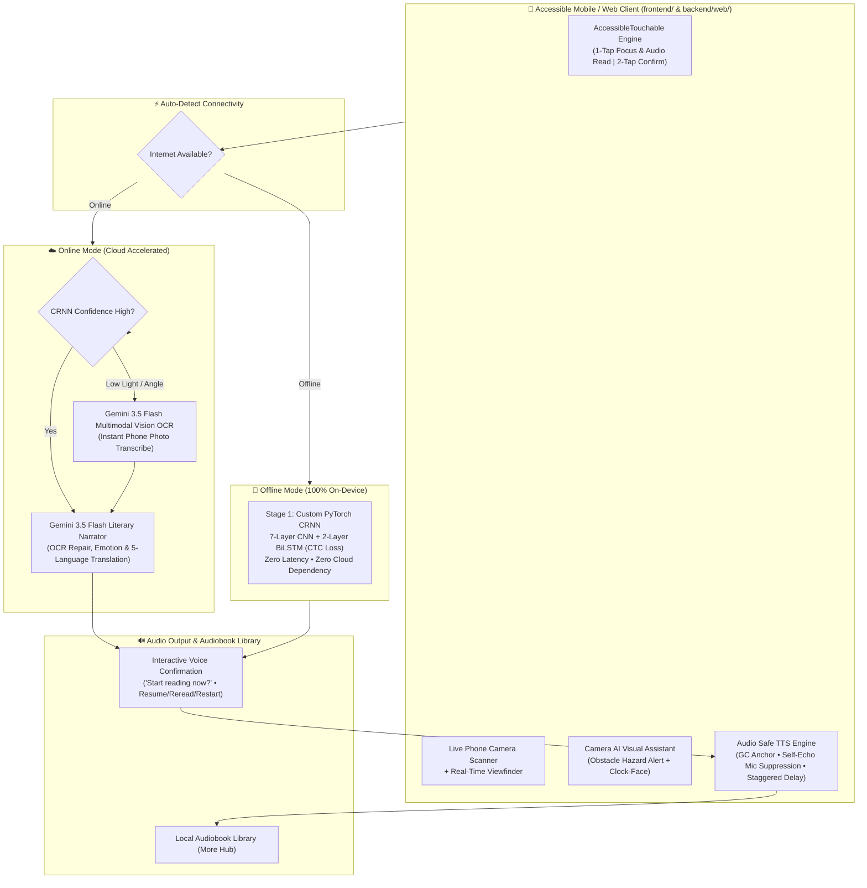

# Blind-ER — Voice-First AI Assistive Ecosystem & Book Scanner

> **AI Innovation Competition Prototype (v2.5.0)** — Empowering visually impaired and completely blind individuals through an audio-first, spatial gesture interface backed by a dual-engine (On-Device PyTorch CRNN + Multimodal Cloud AI) pipeline.

---

## 1. Overview & Core Innovations

Standard OCR readers read text robotically—tripping over hyphenations, reciting line-noise, and relying on visual touch buttons impossible for blind users to navigate.

**Blind-ER** reimagines assistive technology with a **Zero-Sight Spatial Interface**, **Dual-Engine Auto-Network Switching**, and a **Context-Aware Audio-First Pipeline**:



---

## 2. Key Technical Highlights

| Feature / Layer | Implementation | Technical Innovation |
| :--- | :--- | :--- |
| **Dual-Engine Offline Mode** | `backend/services/crnn_service.py` & `backend/web/app.js` | Automatically senses network availability. When offline, operates 100% locally via Hariths's custom PyTorch CRNN model (`crnn_book_scanner.pth`, 76 CTC classes) with zero cloud dependency. |
| **Hybrid Vision OCR** | `backend/routes/scanner_routes.py` | Combines local CRNN character strips with `gemini-3.5-flash` multimodal vision fallback for challenging smartphone camera angles, uneven lighting, and curved pages. |
| **Interactive Spoken Navigation** | `BookScannerScreen.js` & `app.js` | Asks the user: *"Page scanned successfully. Would you like me to start reading now?"* Pausing prompts: *"Resume from current sentence, reread last sentence, or restart from page start."* |
| **Audio-Safe TTS & Mic Shield** | `frontend/src/logic/ttsService.js` & `backend/web/app.js` | Prevents audio cut-off via persistent utterance garbage collection anchoring (`window.activeSpeechUtterance`) and suppresses mic self-echo while speaking. |
| **Blind-Optimized Scene AI** | `backend/routes/assistant_routes.py` (`/api/describe-scene`) | Strictly prioritizes safety hazards (stairs, curbs, obstacles) and provides spatial clock-face orientations (*"At 12 o'clock, 1 meter ahead..."*) with zero visual jargon. |
| **Pitch Training Delay** | `AuditoryGamesScreen.js` | Musical pitch tones play with a calibrated pre-delay so notes never collide with TalkBack / VoiceOver spoken screen labels. |
| **Chaos QA Suite** | `frontend/__tests__/AccessibilityChaosQA.test.js` | 13 automated tests verifying double-tap debounce, audio interruption, gesture safety, and camera timeout fallbacks. |

---

## 3. System Architecture & Component Mapping

```
Blind-ER/
├── backend/
│   ├── config/
│   │   └── settings.py              # Pydantic configuration & Gemini API key loader
│   ├── models/
│   │   └── crnn_book_scanner.pth    # PyTorch CRNN weights (7-layer CNN + 2-layer BiLSTM)
│   ├── routes/
│   │   ├── assistant_routes.py      # /api/describe-scene & /api/voice-command
│   │   └── scanner_routes.py        # /api/scan-book-page, /api/demo-scan, /api/hardware-assist
│   ├── services/
│   │   ├── crnn_service.py          # PyTorch OCR inference & line segmentation
│   │   └── llm_service.py           # Gemini 3.5 Flash contextualization & translation
│   ├── web/                         # Lightweight responsive web client (runs on mobile & desktop)
│   │   ├── index.html               # Semantic accessible layout with offline status badge
│   │   ├── app.js                   # Universal gesture engine, camera capture, speech synthesis
│   │   └── app.css                  # WCAG AAA high-contrast styling
│   ├── main.py                      # FastAPI middleware entry point
│   └── train_crnn.py                # CRNN training script (40 epochs, CTC Loss)
│
├── frontend/                        # React Native (Expo) Mobile App
│   ├── src/
│   │   ├── api/scannerApi.js        # Strict 8s timeout fetch wrapper with fallback handling
│   │   ├── logic/
│   │   │   ├── ttsService.js        # Speech synthesis controller with queue management
│   │   │   ├── useScannerController.js # Audio-guided book reading & sentence-level pause/resume
│   │   │   └── hardwarePlaceholder.js # Meta Smart Glasses & Be My Eyes SDK bridge
│   │   └── ui/
│   │       ├── components/
│   │       │   ├── AccessibleTouchable.js # 1-Tap Read, 2-Tap Fire gesture engine
│   │       │   └── FeatureLayoutTemplate.js # High-contrast spatial layout with bottom navigation
│   │       └── screens/
│   │           ├── BookScannerScreen.js   # Phone camera scanner with interactive read prompts
│   │           ├── CameraAssistantScreen.js # Real-time visual scene descriptor for blind users
│   │           ├── AuditoryGamesScreen.js # Pitch training with TalkBack-safe audio staggering
│   │           ├── HomeScreen.js          # Minimalist hero navigation
│   │           ├── MoreHubScreen.js       # Saved audiobook library
│   │           └── SettingsScreen.js      # Volume, speech rate, pitch & language options
│   └── __tests__/
│       └── AccessibilityChaosQA.test.js # 13/13 passing automated chaos test suite
│
└── docs/
    └── pitch_drafts/                # Competition slides, scripts, and judge Q&A guides
```

---

## 4. Quick Start

### 1. Run the FastAPI AI Middleware (`backend/`)
```powershell
cd backend
python -m venv .venv
.\.venv\Scripts\Activate.ps1
pip install -r requirements.txt

# Set GEMINI_API_KEY in backend/.env
python -m uvicorn main:app --host 0.0.0.0 --port 8000 --reload
```
* **Web App & Mobile Viewfinder:** `http://localhost:8000`
* **Interactive OpenAPI Docs:** `http://localhost:8000/docs`

### 2. Run the React Native Mobile App (`frontend/`)
```powershell
cd frontend
npm install
npx expo start
```

### 3. Run Automated Accessibility Chaos Tests
```powershell
cd frontend
npx jest --verbose
```
*(All 13 tests verify tactile gestures, TTS resilience, and timeout recovery.)*

---

## 5. Accessibility Compliance
* **WCAG 2.2 Level AAA**: High-contrast ratios (> 7:1) using `#000000` black, `#FFD600` safety yellow, and `#00E5FF` electric cyan.
* **Non-Visual Usability**: 100% operability with screen closed via auditory earcons and distinct vibration ticks.
* **Voice-First Error Recovery**: Immediate spoken status messages whenever permissions, lighting, or network states change.
