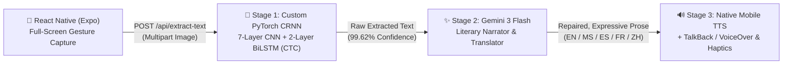

# Blind-ER — Context-Aware Book-to-Audiobook Scanner

> **AI Innovation Competition Prototype** — Empowering visually impaired and partially blind readers by transforming physical books into expressive, multilingual audiobooks.

---

## 1. Overview & Competitive Edge

Standard OCR-to-speech readers translate scanned book pages robotically and literally—reading out broken line hyphenations, stray page numbers, and word-for-word machine translations that destroy emotional tone and narrative flow. Furthermore, existing scanning apps depend on small visual buttons that are difficult to operate without sight.

**Blind-ER** solves this through a **Zero-Button, Full-Screen Gesture Interface** backed by a **3-Stage Context-Aware AI Pipeline**:



---

## 2. Key Technical Highlights

| Layer | Technology | Innovation & Implementation |
| :--- | :--- | :--- |
| **Stage 1: Custom OCR** | PyTorch CRNN (`backend/services/crnn_service.py`) | Custom 7-layer CNN + 2-layer Bidirectional LSTM (`hidden_size=256`, 76 CTC classes) trained over 40 epochs (`backend/train_crnn.py`) on dynamic book typography with Gaussian focus-blur augmentation. |
| **Stage 2: Context & Translation** | Gemini 3 Flash (`backend/services/llm_service.py`) | Repairs broken OCR words/headers and translates smoothly into **English, Malay, Spanish, French, and Mandarin** while preserving literary genre and emotional nuance. |
| **Stage 3: Accessible Audio & UI** | React Native + Expo (`frontend/src/`) | **WCAG AAA High-Contrast UI** (`#000000` / `#FFD600` / `#00E5FF`) with a full-screen touch responder (**1 Tap** = Scan, **2 Taps** = Pause/Replay, **Long Press** = Switch Language) and native Android TalkBack / iOS VoiceOver integration. |
| **Security & Architecture** | `.env` + Strict UI/Logic Separation | Zero hardcoded API keys. Frontend styling (`frontend/src/ui/`) is strictly decoupled from camera & AI state controllers (`frontend/src/logic/`). |

---

## 3. Repository Structure & Team Guides

- **[`PROJECT_TUTORIAL.md`](./PROJECT_TUTORIAL.md):** Complete directory tree, architectural boundaries, and **Matthew's UI/UX Styling Guide**.
- **[`TEAM_AI_CONTEXT.txt`](./TEAM_AI_CONTEXT.txt):** Master context file and prompt templates for **Matthew (UI/UX Lead)** and **Nijad (Pitch Deck & Feature Lead)**.
- **[`docs/pitch_drafts/`](./docs/pitch_drafts/):** Competition slide copy and timed video voiceover scripts for the Problem Statement, System Architecture, Accessible Workflow, and Future Ecosystem Roadmap (Audio Pitch Training Games & IoT Home Cameras).
- **[`backend/train_crnn.py`](./backend/train_crnn.py):** Complete PyTorch training script for the custom CRNN model.

---

## 4. Quick Start

### 1. Run the FastAPI AI Middleware (`backend/`)
```powershell
cd backend
python -m venv .venv
.\.venv\Scripts\Activate.ps1
pip install -r requirements.txt

# Copy .env.example to .env and set your GEMINI_API_KEY
uvicorn main:app --host 0.0.0.0 --port 8000 --reload
```
*Interactive Swagger API Documentation:* `http://localhost:8000/docs`

### 2. Run the React Native Mobile App (`frontend/`)
```powershell
cd frontend
npm install
npx expo start
```
