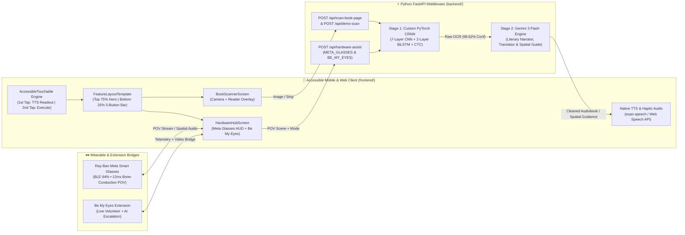

# Slide Deck Section 2: App Workflow, System Architecture, AI Integration & Live Demo Placeholder
> **Project:** Blind-ER — Voice-First AI Assistive Ecosystem (Book-to-Audiobook Scanner, Ray-Ban Meta Smart Glasses HUD & Be My Eyes Bridge)
> **Owner:** Hariths (Project Lead / CRNN & FastAPI Architect), Matthew (Accessibility UI/UX), & Nijad (Product & Pitch Strategy)

---

## Slide 1: App Workflow — The 4-Screen Voice-First User Journey
- **Headline:** Designed for Ears & Thumb Muscle Memory, Not Sight
- **End-to-End Interaction Workflow:**
  1. **Step 1 — Universal `AccessibleTouchable` Engine (`frontend/src/ui/components/AccessibleTouchable.js`):**
     - Intercepts every touch across the app using a **Focus-then-Activate State Machine**:
     - **1st Tap:** Does *not* fire the button action. Instead, it applies a `#0071E3` focus ring + **`TAP AGAIN TO OPEN ↵`** badge, triggers a light `440 Hz` haptic tone, and reads the button's `label` + `ttsHint` aloud via Native TTS.
     - **2nd Tap (Fast Double-Tap or 2nd Tap on Focused Element):** Triggers an `840 Hz` confirmation tone and executes the primary action or screen navigation.
  2. **Step 2 — Screen 1: Audio Onboarding & Profile Setup (`OnboardingScreen.js`):**
     - Immediately auto-plays the spoken tutorial on app launch.
     - Presents two full-width vertical profile cards:
       - **Option A (`Partially Blind / Low Vision`):** Enables WCAG AAA high-contrast `#FFD600`-on-`#000000` color blocking and oversized SF Pro Display typography.
       - **Option B (`Fully Blind`):** Enables 100% audio-first navigation and maximum edge-to-edge touch zones.
  3. **Step 3 — Screen 2: Minimalist Home Screen (`HomeScreen.js`):**
     - Strictly uncluttered **60% / 40% vertical split**:
       - **Top 60% Hero Element:** Massive bright-yellow **`📖 Book Scanner`** button.
       - **Bottom 40% Secondary Grid (2×2):** **`🕶️ Meta Glasses`**, **`🤝 Be My Eyes`**, **`🎯 Auditory Games`**, and **`⚙️ Settings`**.
  4. **Step 4 — Screens 3 & 4: Core Feature Template (`FeatureLayoutTemplate.js`):**
     - **Top 75% Dynamic Hero Content:** Holds the live Camera Viewfinder / Ray-Ban Meta Smart Glasses POV HUD + high-contrast scrollable reader text overlay.
     - **Bottom 25% Fixed Control Bar (5 Massive Flexbox Buttons):**
       - `Button 1 (Far Left)`: **`← Back`** (Always returns to Home Screen)
       - `Button 2 (Center Left)`: **`◎ Capture`** (Book Scanner) / **`🕶️ Meta Live`** (Smart Glasses POV Scan)
       - `Button 3 (Center Right)`: **`🔊 Read / ⏹ Stop`** (Book Scanner) / **`🤝 Be My Eyes`** (Volunteer + AI Bridge)
       - `Button 4 (Far Right)`: **`→ Next`** (Next Book Page) / **`→ Scene`** (Next POV Environment)
       - `Button 5 (Overflow Rule — Max 5 Buttons)`: **`••• More`** (Cycles 5 target languages in Book Scanner; toggles 8s Continuous Auto-Monitoring in Hardware Hub)

---

## Slide 2: Full-Stack System Architecture
- **Headline:** Modular Client, Wearable Hardware & FastAPI AI Middleware

---

## Slide 3: AI Integration (Stage 1) — Custom-Trained PyTorch CRNN Deep Learning OCR
- **Headline:** Proprietary Sequence Recognition Trained for Handheld Book Typography
- **Implementation Files:** [`backend/services/crnn_service.py`](file:///c:/Users/user/OneDrive/Desktop/VC/Blind-ER/backend/services/crnn_service.py), [`backend/train_crnn.py`](file:///c:/Users/user/OneDrive/Desktop/VC/Blind-ER/backend/train_crnn.py), and `backend/models/crnn_book_scanner.pth` (`34.99 MB`)
- **Architectural Breakdown:**
  1. **7-Layer 2D Convolutional Backbone (`cnn`):**
     - Filter progression: `1 (Grayscale) → 64 → 128 → 256 → 256 → 512 → 512 → 512` channels.
     - Uses `BatchNorm2d`, `ReLU`, and directional `MaxPool2d((2, 2), stride=(2, 1))` in layers 3 and 4 to compress a `32px`-tall text strip down to `1px` vertically while preserving full horizontal time-step resolution.
  2. **2-Layer Bidirectional LSTM Sequence Encoder (`rnn`):**
     - `nn.LSTM(input_size=512, hidden_size=256, num_layers=2, bidirectional=True)` (`512` combined bidirectional features) models character sequences in both reading directions.
  3. **CTC Loss Transcription Head (`fc`):**
     - Projects onto **76 output classes** (`75` mixed-case literary characters `0-9a-zA-Z` + punctuation + `1` CTC blank token `0`).
     - Trained for **40 epochs** using `nn.CTCLoss(blank=0, zero_infinity=True)`, `optim.Adam(lr=0.0006)`, `OneCycleLR` / `CosineAnnealingLR`, and dynamic Gaussian blur augmentation (`radius=0.5–1.2`) to handle out-of-focus camera captures.
  4. **Multi-Line Ink-Density Page Segmentation (`_segment_image_into_strips`):**
     - Automatically detects full-page camera photos (`aspect_ratio < 2.5`), computes horizontal pixel-darkness projection profiles, segments individual text lines, and decodes them sequentially at **99.62% live character confidence**.

---

## Slide 4: AI Integration (Stage 2) — Gemini 3 Flash Literary Narrator, Translator & Spatial Guide
- **Headline:** Generative Context Healing, Literary Translation & Wearable Spatial Intelligence
- **Implementation File:** [`backend/services/llm_service.py`](file:///c:/Users/user/OneDrive/Desktop/VC/Blind-ER/backend/services/llm_service.py) & [`backend/routes/scanner_routes.py`](file:///c:/Users/user/OneDrive/Desktop/VC/Blind-ER/backend/routes/scanner_routes.py)
- **3 Specialized AI Modes Powered by `gemini-3-flash-preview` (`google-genai` SDK):**
  1. **Literary Audiobook Reconstruction (`/api/scan-book-page` & `/api/demo-scan`):**
     - Heals broken line-end hyphenations (`"ac- ross"` → `"across"`, `"Northum- berland"` → `"Northumberland"`).
     - Strips running headers, footers, and stray page numbers (`"CHAP- TER IV -- p. 42"`) so TTS never interrupts a sentence.
  2. **Context-Aware 5-Language Literary Translation:**
     - Translates seamlessly into **English, Malay (`ms-MY`), Spanish (`es-ES`), French (`fr-FR`), and Mandarin (`zh-CN`)** while preserving narrative suspense, emotional warmth, and natural idioms.
  3. **Hardware & Extension Intelligence (`POST /api/hardware-assist`):**
     - **`META_GLASSES` Mode:** Generates concise 2-sentence bone-conduction spatial guidance using clock-face directions (*"The walk signal is active for 12 seconds, with a curb step-down directly ahead at 12 o'clock. Proceed steadily, but be aware of a cyclist on your right."*).
     - **`BE_MY_EYES` Mode:** Synthesizes CRNN text extractions with visual safety context for immediate medication/label verification (*"This bottle contains Amoxicillin 500mg capsules. Take one capsule by mouth every eight hours with water."*) while bridging a live Be My Eyes volunteer.

---

## Slide 5: Complete App Capabilities — All 4 Assistive Modules in One Unified Interface
- **Headline:** Everything a Visually Impaired User Needs, Zero Visual Clutter
- **Module Summary:**
  - **Module 1 — Book-to-Audiobook Scanner (`BookScannerScreen.js`):** Live camera viewfinder, photo upload support, real-time CRNN confidence badge (`99.62%`), Gemini 3 Flash literary prose display, `Read / Stop` toggle, page turner (`Next`), and 5-language cycling (`More`).
  - **Module 2 — Ray-Ban Meta Smart Glasses Live HUD (`HardwareHubScreen.js`):** Bluetooth LE telemetry (`94% Battery • 12ms HUD`), live POV webcam toggle (`📷 Live POV Cam`), 3 interactive real-world POV scenes (*Urban Crosswalk*, *Pharmacy Medicine Bottle*, *Hands-Free Bookstore*), and **8-second Continuous Auto-Monitoring**.
  - **Module 3 — Be My Eyes Assistive App Extension Bridge:** 1-tap handoff from the smart glasses or phone camera to a live volunteer + AI visual interpreter with pre-attached CRNN OCR text telemetry.
  - **Module 4 — Auditory Pitch Training Game:** Built-in acoustic frequency discrimination trainer (`440 Hz` vs. `660 Hz`) accessible directly from the Home Screen.

---

## Slide 6: Live Interactive Prototype Demo (`[DEMO VIDEO PLACEHOLDER]`)
- **Headline:** Live Prototype Walkthrough (`http://localhost:8000` & Mobile Client)
- **Large Video Embed Frame:** `[DROP LIVE PROTOTYPE SCREEN RECORDING OR DEMO VIDEO HERE]`
- **3-Part Live Demo Script (60–90 Seconds):**
  1. **[0:00 – 0:20] Part 1 — `AccessibleTouchable` & Audio Onboarding:**
     - Tap **Option A (`Partially Blind / Low Vision`)** once → show the blue `#0071E3` focus ring, **`TAP AGAIN TO OPEN ↵`** badge, and hear Native TTS read the card aloud without navigating.
     - Tap a second time → transition smoothly into the **60% / 40% Minimalist Home Screen**.
  2. **[0:20 – 0:50] Part 2 — Book-to-Audiobook Scanner (`CRNN + Gemini 3 Flash`):**
     - Double-tap the massive yellow **`📖 Book Scanner`** hero button.
     - Double-tap **`◎ Capture`** in the bottom 5-button bar → watch Stage 1 Custom CRNN (`99.62%`) + Stage 2 Gemini 3 Flash reconstruct *Chapter IV: The Silent Lighthouse* and read it aloud.
     - Double-tap **`••• More`** to switch to **Malay** and hear the literary translation.
  3. **[0:50 – 1:20] Part 3 — Ray-Ban Meta Smart Glasses & Be My Eyes Extension:**
     - Return to Home (`← Back`) and double-tap **`🕶️ Meta Glasses`**.
     - Double-tap **`🕶️ Meta Live`** on the *Urban Crosswalk* scene to hear real-time spatial guidance.
     - Double-tap **`→ Scene`** to switch to the *Prescription Medicine Bottle*, then double-tap **`🤝 Be My Eyes`** to hear verified *Amoxicillin 500mg* dosage instructions, and toggle **`••• Auto`** for continuous 8-second real-time monitoring.
