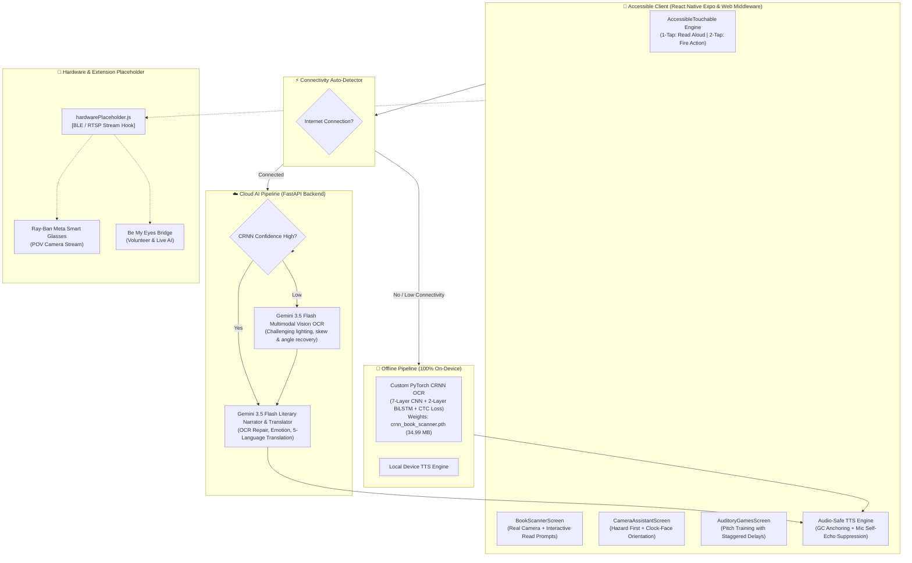

# Slide Deck Section 2: App Workflow, System Architecture, AI Integration, Hardware Placeholder & Live Demo
> **Project:** Blind-ER — Voice-First AI Assistive Ecosystem (`v2.5.0`)
> **Owner:** Hariths (Project Lead / CRNN & FastAPI Architect), Matthew (Accessibility UI/UX), & Nijad (Product & Pitch Strategy)

---

## Slide 1: App Workflow — The Voice-First User Journey
- **Headline:** Designed for Ears & Thumb Muscle Memory, Not Sight
- **End-to-End Interaction Workflow:**
  1. **Step 1 — Universal `AccessibleTouchable` Engine (`frontend/src/ui/components/AccessibleTouchable.js`):**
     - Intercepts every touch across the app using a **Focus-then-Activate State Machine**:
     - **1st Tap:** Focuses the button (`#0071E3` ring + **`TAP AGAIN TO OPEN ↵`** badge), plays a `440 Hz` haptic tone, and reads the button's `label` + `ttsHint` aloud via Native TTS without firing the action.
     - **2nd Tap:** Plays an `840 Hz` confirmation tone and executes the action.
  2. **Step 2 — Interactive Book Scanner & Camera (`BookScannerScreen.js` / Web Viewfinder):**
     - Integrates directly with the device camera.
     - **Pre-Read Confirmation:** Once captured, the system asks: *"Page scanned successfully. Would you like me to start reading now?"*
     - **State-Preserving Pause / Resume:** When paused, asks: *"Resume from current sentence, reread last sentence, or restart from page start."*
  3. **Step 3 — Camera AI Visual Assistant (`CameraAssistantScreen.js` / `/api/describe-scene`):**
     - Sends live camera frames to Gemini 3.5 Flash for environmental awareness.
     - Enforces strict safety priority: immediate hazard warnings first (stairs, drop-offs, curbs, moving traffic), followed by body-relative clock-face coordinates (*"At 12 o'clock, 1 meter ahead..."*).
  4. **Step 4 — Auditory Pitch Training (`AuditoryGamesScreen.js`):**
     - Calibrated pre-delay prevents musical game notes from overlapping with TalkBack / VoiceOver screen-reader utterances.

---

## Slide 2: Full-Stack System Architecture & Dual-Engine Fallback

---

## Slide 3: AI Integration (Stage 1) — Custom-Trained PyTorch CRNN Deep Learning OCR
- **Implementation Files:** [`backend/services/crnn_service.py`](file:///c:/Users/user/OneDrive/Desktop/VC/Blind-ER/backend/services/crnn_service.py), [`backend/train_crnn.py`](file:///c:/Users/user/OneDrive/Desktop/VC/Blind-ER/backend/train_crnn.py), and `backend/models/crnn_book_scanner.pth` (`34.99 MB`)
- **Architectural Breakdown:**
  1. **7-Layer 2D Convolutional Backbone:** Filter progression `1 → 64 → 128 → 256 → 256 → 512 → 512 → 512` with `BatchNorm2d`, `ReLU`, and directional `MaxPool2d((2, 2), stride=(2, 1))` collapsing `32px` height to `1px`.
  2. **2-Layer Bidirectional LSTM Encoder:** `hidden_size=256` (`512` bidirectional features) modeling left-to-right and right-to-left character sequences.
  3. **CTC Loss Transcription Head:** **76 output classes** (`75` mixed-case characters + `1` CTC blank token), trained over **40 epochs** (`lr=0.0006`) with Gaussian blur augmentation.
  4. **Multi-Line Ink-Density Segmentation:** Automatically slices full book pages into horizontal line strips.
  5. **Zero Cloud Latency:** Powers the offline mode when no Wi-Fi or cellular signal is present.

---

## Slide 4: AI Integration (Stage 2) — Gemini 3.5 Flash Literary Narrator & Multimodal Vision
- **Implementation Files:** [`backend/services/llm_service.py`](file:///c:/Users/user/OneDrive/Desktop/VC/Blind-ER/backend/services/llm_service.py) & [`backend/routes/assistant_routes.py`](file:///c:/Users/user/OneDrive/Desktop/VC/Blind-ER/backend/routes/assistant_routes.py)
- **Core Capabilities:**
  1. **OCR Artifact Healing:** Reconstructs broken line-end hyphenations (`"Northum- berland"` → `"Northumberland"`) and removes stray page numbers (`"p. 42"`).
  2. **Emotion-Preserving 5-Language Translation:** Translates naturally into **English, Malay, Spanish, French, and Mandarin** while preserving literary tone and idioms.
  3. **Multimodal Vision Fallback:** When camera lighting or angle degrades character strip segmentation, Gemini 3.5 Flash Vision transcribes the entire page in under 1.5 seconds.
  4. **Blind-First Scene Understanding:** Strictly structures visual scene descriptions around physical safety, height, and clock-face coordinates without visual buzzwords.

---

## Slide 5: Hardware & Extension Integration Placeholder (`[HARDWARE SDK HOOK]`)
- **Implementation Files:** [`frontend/src/logic/hardwarePlaceholder.js`](file:///c:/Users/user/OneDrive/Desktop/VC/Blind-ER/frontend/src/logic/hardwarePlaceholder.js) & [`frontend/src/ui/screens/HardwareHubScreen.js`](file:///c:/Users/user/OneDrive/Desktop/VC/Blind-ER/frontend/src/ui/screens/HardwareHubScreen.js)
- **Plug-and-Play Hardware Integration Slots (Inside `More → Extensions`):**
  - **`[PLACEHOLDER 1 — Wearable Camera Stream (Ray-Ban Meta Smart Glasses / ESP32-CAM)]`:**
    - Modular hook `connectWearableDevice()` & `captureWearableFrame()` ready to bind to the Meta Wearables Device Access Toolkit (DAT) SDK or an external Wi-Fi/BLE camera stream (`ws://` / `rtsp://`).
  - **`[PLACEHOLDER 2 — Bone-Conduction & Tactile Haptic Output]`:**
    - Modular hook `sendBoneConductionAudio()` & `triggerSmartCaneVibration()` for Bluetooth LE audio glasses and ultrasonic smart canes.
  - **`[PLACEHOLDER 3 — Assistive App Extension Bridge (Be My Eyes)]`:**
    - Modular hook `openBeMyEyesExtension()` that packages the latest CRNN OCR text + camera frame and hands off to a live volunteer or AI visual interpreter.

---

## Slide 6: Live Interactive Prototype Demo (`[DEMO VIDEO PLACEHOLDER]`)
- **Large Video Embed Frame:** `[DROP LIVE PROTOTYPE SCREEN RECORDING HERE]`
- **Demo Walkthrough (`http://localhost:8000`):**
  1. **Welcome Setup:** Show `Option A (Low Vision WCAG AAA)` & `Option B (Fully Blind Audio-First)` with the live **Audio Waveform Visualizer** and `1st Tap Read / 2nd Tap Open` engine.
  2. **Dual-Engine Book Scanner:** Capture a book page, confirm the read prompt (*"Start reading now?"*), test sentence-level pause/resume, and demonstrate offline mode switching via the live network badge.
  3. **Camera Visual Assistant:** Run `/api/describe-scene` and hear spoken hazard warnings with clock-face orientation.
  4. **Auditory Games & Settings:** Play pitch training without TalkBack collisions and adjust voice parameters.
