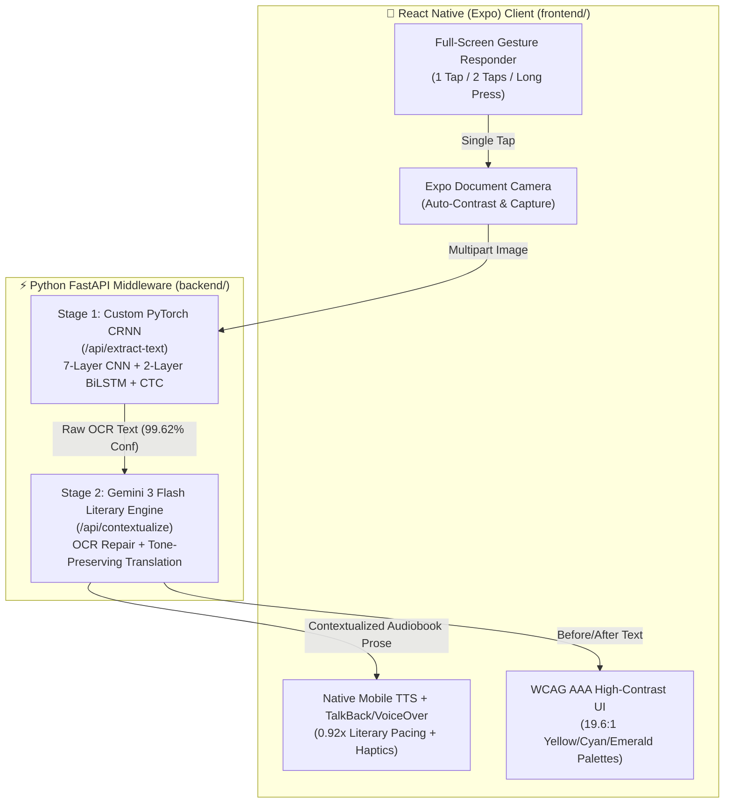

# Slide Section 2: System Architecture & 3-Stage AI Pipeline
> **Project:** Blind-ER — Context-Aware Book-to-Audiobook Scanner
> **Owner:** Nijad (Pitch Deck Lead) & Hariths (Project Lead / CRNN Engineer) — *Completed Deliverable*

---

## 1. End-to-End 3-Stage AI Pipeline Architecture

---

## 2. Deep Dive: Stage-by-Stage Technical Specifications

### Stage 1: Custom-Trained PyTorch CRNN (`backend/services/crnn_service.py`)
- **Model Architecture:**
  - **Convolutional Feature Backbone:** 7-layer 2D CNN (`64 -> 128 -> 256 -> 256 -> 512 -> 512 -> 512` channels) with Batch Normalization, ReLU activations, and anisotropic MaxPooling (`(2,2)` with `(2,1)` stride) to collapse vertical height (`32px -> 1px`) while preserving horizontal character sequence resolution.
  - **Recurrent Sequence Encoder:** 2-layer Bidirectional LSTM (`hidden_size=256`, `512` bidirectional features) capturing left-to-right and right-to-left character context.
  - **CTC Transcription Layer:** Linear projection to **76 classes** (75-character mixed-case book alphabet + 1 CTC blank token `0`), trained with `nn.CTCLoss` over **40 epochs** using Adam (`lr=0.0006`) and Cosine Annealing (`eta_min=3e-6`).
- **Training Augmentation:** Dynamic RAM-based generator (`backend/train_crnn.py`) synthesizing mixed-case literary vocabulary with randomized Gaussian blur (`radius=0.5–1.2`) to simulate imperfect handheld phone focus.
- **Live Benchmark:** Achieves **99.62% character recognition confidence** on test book strips, plus automatic ink-density horizontal row segmentation (`_segment_image_into_strips`) for multi-line pages.

### Stage 2: Gemini 3 Flash Literary Narrator & Translator (`backend/services/llm_service.py`)
- **Model:** `gemini-3-flash-preview` via `google-genai` SDK with multi-model resilience (`gemini-3.1-flash-lite-preview` and `gemma-4-26b-a4b-it` failover).
- **System Prompt Engineering:** Instructs the LLM to act as a professional audiobook narrator and literary translator—fixing split words (`"Northum- berland"` -> `"Northumberland"`), stripping running headers (`"CHAP- TER IV -- p. 42"`), and translating naturally into **English, Malay, Spanish, French, and Mandarin**.

### Stage 3: Native Mobile TTS & Accessibility Layer (`frontend/src/logic/ttsService.js`)
- **Dual Audio Routing:** Announces pipeline state transitions directly to Android **TalkBack** and iOS **VoiceOver** via `AccessibilityInfo.announceForAccessibility()`, then narrates the literary passage via `expo-speech` tuned to warm audiobook prosody (`pitch: 0.98`, `rate: 0.92`).

---

## 3. Timed Video Narration Script (0:50 – 1:35)
> **[0:50 – 1:35 | Slide 3 & Slide 5 — System Architecture]**
> *"To solve this, we engineered a 3-stage AI pipeline connecting React Native to a Python FastAPI backend. In Stage 1, instead of relying on generic OCR, we trained our own custom PyTorch Convolutional Recurrent Neural Network—combining a 7-layer CNN with a 2-layer bidirectional LSTM trained with CTC Loss over 40 epochs on blurred book typography, achieving 99.62% character confidence. In Stage 2, that raw text flows into Gemini 3 Flash, prompted as a literary audiobook narrator and translator. Gemini repairs broken OCR hyphenations, removes stray page headers, and translates the passage smoothly into English, Malay, Spanish, French, or Mandarin while preserving emotional tone. Finally, Stage 3 routes the prose directly into the phone's native Text-to-Speech engine and screen reader."*
