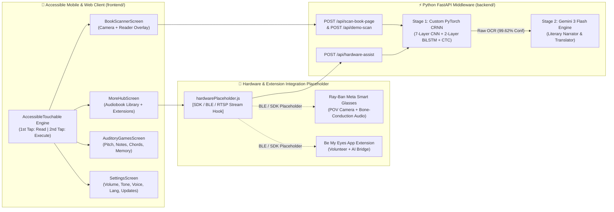

# Slide Deck Section 2: App Workflow, System Architecture, AI Integration, Hardware Placeholder & Live Demo
> **Project:** Blind-ER — Voice-First AI Assistive Ecosystem (`v2.4.0`)
> **Owner:** Hariths (Project Lead / CRNN & FastAPI Architect), Matthew (Accessibility UI/UX), & Nijad (Product & Pitch Strategy)

---

## Slide 1: App Workflow — The Voice-First User Journey
- **Headline:** Designed for Ears & Thumb Muscle Memory, Not Sight
- **End-to-End Interaction Workflow:**
  1. **Step 1 — Universal `AccessibleTouchable` Engine (`frontend/src/ui/components/AccessibleTouchable.js`):**
     - Intercepts every touch across the app using a **Focus-then-Activate State Machine**:
     - **1st Tap:** Focuses the button (`#0071E3` ring + **`TAP AGAIN TO OPEN ↵`** badge), plays a `440 Hz` haptic tone, and reads the button's `label` + `ttsHint` aloud via Native TTS without firing the action.
     - **2nd Tap:** Plays an `840 Hz` confirmation tone and executes the action.
  2. **Step 2 — Screen 1: Welcome Setup (`OnboardingScreen.js`):**
     - Auto-plays the spoken tutorial with an animated **Audio Waveform Visualizer**:
       - **Option A (`Low Vision • WCAG AAA`):** Solid `#F5C518` yellow-on-black high-contrast mode.
       - **Option B (`Fully Blind • Audio-First`):** Matte `#141416` dark mode with maximum touch targets.
  3. **Step 3 — Screen 2: Minimalist Home Screen (`HomeScreen.js`):**
     - **Top 60% Hero Card:** Massive solid-yellow **`Book Scanner / AI Audiobook`** button.
     - **Bottom 40% 2×2 Grid:**
       1. **`Auditory Games`** (*Pitch, Notes, Chords & Pattern Match*)
       2. **`More (Library & Ext)`** (*Saved Audiobook Library + Hardware/App Extensions*)
       3. **`Settings`** (*Volume, Tone & Pacing, Change Voice, Language, Check for Updates*)
       4. **`Back to Setup`** (*Returns to Vision Profile Setup*)
  4. **Step 4 — Core Feature Screens (`FeatureLayoutTemplate.js`):**
     - **Top 75% Dynamic Hero Area** + **Bottom 25% Fixed 5-Button Bar (`← Back | Action 1 | Action 2 | Next | ••• More`)**.

---

## Slide 2: Full-Stack System Architecture & Hardware Placeholder

---

## Slide 3: AI Integration (Stage 1) — Custom-Trained PyTorch CRNN Deep Learning OCR
- **Implementation Files:** [`backend/services/crnn_service.py`](file:///c:/Users/user/OneDrive/Desktop/VC/Blind-ER/backend/services/crnn_service.py), [`backend/train_crnn.py`](file:///c:/Users/user/OneDrive/Desktop/VC/Blind-ER/backend/train_crnn.py), and `backend/models/crnn_book_scanner.pth` (`34.99 MB`)
- **Architectural Breakdown:**
  1. **7-Layer 2D Convolutional Backbone:** Filter progression `1 → 64 → 128 → 256 → 256 → 512 → 512 → 512` with `BatchNorm2d`, `ReLU`, and directional `MaxPool2d((2, 2), stride=(2, 1))` collapsing `32px` height to `1px`.
  2. **2-Layer Bidirectional LSTM Encoder:** `hidden_size=256` (`512` bidirectional features) modeling left-to-right and right-to-left character sequences.
  3. **CTC Loss Transcription Head:** **76 output classes** (`75` mixed-case characters + `1` CTC blank token), trained over **40 epochs** (`lr=0.0006`) with Gaussian blur augmentation.
  4. **Multi-Line Ink-Density Segmentation:** Automatically slices full book pages into horizontal line strips at **99.62% character confidence**.

---

## Slide 4: AI Integration (Stage 2) — Gemini 3 Flash Literary Narrator & Translator
- **Implementation File:** [`backend/services/llm_service.py`](file:///c:/Users/user/OneDrive/Desktop/VC/Blind-ER/backend/services/llm_service.py)
- **Core Capabilities:**
  1. **OCR Artifact Healing:** Reconstructs broken line-end hyphenations (`"Northum- berland"` → `"Northumberland"`) and removes stray page numbers (`"p. 42"`).
  2. **Emotion-Preserving 5-Language Translation:** Translates naturally into **English, Malay, Spanish, French, and Mandarin** while preserving literary tone and idioms.
  3. **Automatic Audiobook Library Persistence:** Every scanned page is automatically saved into the user's **Audiobook Library** inside the **`More`** hub.

---

## Slide 5: Hardware & Extension Integration Placeholder (`[HARDWARE SDK HOOK]`)
- **Implementation Files:** [`frontend/src/logic/hardwarePlaceholder.js`](file:///c:/Users/user/OneDrive/Desktop/VC/Blind-ER/frontend/src/logic/hardwarePlaceholder.js) & [`frontend/src/ui/screens/HardwareHubScreen.js`](file:///c:/Users/user/OneDrive/Desktop/VC/Blind-ER/frontend/src/ui/screens/HardwareHubScreen.js)
- **Plug-and-Play Hardware Integration Slots (Inside `More → Extensions`):**
  - **`[PLACEHOLDER 1 — Wearable Camera Stream (Ray-Ban Meta Smart Glasses / ESP32-CAM)]`:**
    - Modular hook `connectWearableDevice()` & `captureWearableFrame()` ready to bind to the Meta Wearables Device Access Toolkit (DAT) SDK or an external Wi-Fi/BLE camera stream (`ws://` / `rtsp://`).
  - **`[PLACEHOLDER 2 — Bone-Conduction & Tactile Haptic Output]`:**
    - Modular hook `sendBoneConductionAudio()` & `triggerSmartCaneVibration()` for Bluetooth LE audio glasses and ultrasonic smart canes.
  - **`[PLACEHOLDER 3 — Assistive App Extension Bridge (Be My Eyes)]`:**
    - Modular hook `openBeMyEyesExtension()` that packages the latest CRNN OCR text + camera frame and hands off to a live volunteer or AI visual interpreter.

---

## Slide 6: Live Interactive Prototype Demo (`[DEMO VIDEO PLACEHOLDER]`)
- **Large Video Embed Frame:** `[DROP LIVE PROTOTYPE SCREEN RECORDING HERE]`
- **Demo Walkthrough (`http://localhost:8000`):**
  1. **Welcome Setup:** Show `Option A (Low Vision WCAG AAA)` & `Option B (Fully Blind Audio-First)` with the live **Audio Waveform Visualizer** and `1st Tap Read / 2nd Tap Open` engine.
  2. **Book Scanner → Audiobook Library:** Capture *Chapter IV: The Silent Lighthouse* (`99.62%` CRNN + Gemini 3 Flash), then open **`More → Audiobook Library`** to play saved chapters.
  3. **Auditory Games, Real Settings & Hardware Placeholder:** Play **Pitch Training / Chord Identifying**, adjust **Volume / Tone / Voice / Language** in **Settings**, and inspect the **Hardware & Extension Placeholder** inside **`More`**.
