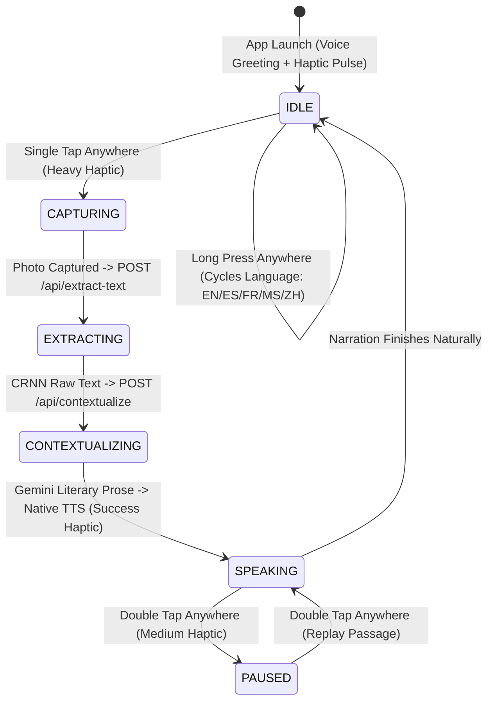

# Slide Section 3: Accessible User Workflow & WCAG AAA Design
> **Project:** Blind-ER — Context-Aware Book-to-Audiobook Scanner
> **Owner:** Nijad (Pitch Deck Lead) & Matthew (UI/UX Accessibility Lead) — *Completed Deliverable*

---

## 1. The Zero-Button, Voice-First User Journey

---

## 2. Full-Screen Gesture & Screen-Reader Matrix

| User Action Anywhere on Screen | Haptic Feedback | TalkBack / VoiceOver Audio Cue | System Action |
| :--- | :--- | :--- | :--- |
| **App Launch** | Soft Notification | *"Blind-ER Book Scanner ready. Single tap anywhere to capture a page..."* | Requests camera permission & initializes TTS. |
| **1 Tap Anywhere** | Heavy Impact | *"Capturing book page. Hold steady..."* -> *"Extracting text..."* -> *"Contextualizing..."* | Snaps photo -> runs CRNN -> runs Gemini 3 Flash -> starts audiobook narration. |
| **2 Taps Anywhere** | Medium Impact | *"Narration paused."* or *"Replaying narration in [Language]."* | Toggles pause or replays the last scanned passage immediately. |
| **Long Press (650ms)** | Heavy Impact | *"Target audiobook language set to Malay. Single tap to scan."* | Cycles through `English`, `Spanish`, `French`, `Malay`, and `Mandarin`. |

---

## 3. WCAG AAA Low-Vision Visual System (`frontend/src/ui/`)
For **partially blind and low-vision users** (who constitute ~85% of the visually impaired community):
- **3 Switchable High-Contrast Palettes (`theme.js`):**
  1. `HYPER_YELLOW`: Safety Yellow (`#FFD600`) on Pure OLED Black (`#000000`) — **19.6:1 contrast ratio** (exceeds WCAG AAA 7:1 minimum by nearly 3x).
  2. `CYBER_CYAN`: High-Vis Cyan (`#00E5FF`) on Pure Black — **16.8:1 contrast ratio** (ideal for tritanopia/red-green color blindness).
  3. `HIGH_LUMINANCE_GREEN`: Accessible Emerald (`#00E676`) on Pure Black — **15.4:1 contrast ratio** (reduces glare fatigue).
- **Scalable Large-Print Reader (`TranscriptCard.jsx`):** Instant `24pt` to `30pt XL` font toggle plus a **"Before vs. After AI" comparison panel** showing Stage 1 Raw CRNN OCR alongside Stage 2 Gemini Literary Prose.

---

## 4. Timed Video Narration Script (1:35 – 2:10)
> **[1:35 – 2:10 | Slide 4 — Accessible User Workflow]**
> *"A powerful AI pipeline means nothing if a blind user cannot operate the interface. That is why we eliminated traditional small buttons altogether. The entire mobile screen acts as a single, zero-precision touch surface paired with tactile haptics and native TalkBack and VoiceOver announcements. A single tap anywhere scans the book page. A double tap anywhere pauses or replays the audiobook. And a long press anywhere cycles the translation language. For partially sighted users, our interface provides three switchable WCAG Triple-A color palettes with up to a 19.6-to-1 contrast ratio and 30-point extra-large typography."*
